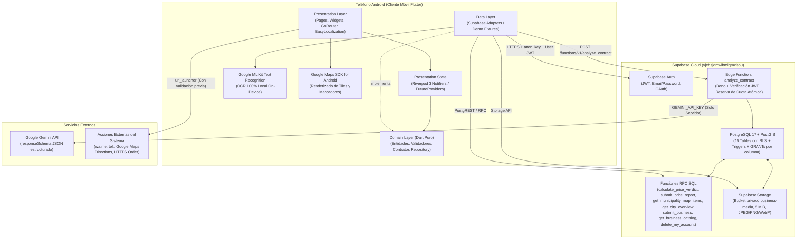

# Arquitectura del Sistema — Vía Justa MVP (`VJ-21`)

## 1. Visión de Extremo a Extremo (End-to-End Architecture)

El sistema **Vía Justa MVP** combina una aplicación móvil Android en **Flutter** estructurada en 3 capas limpias (`Presentation` → `Domain` ← `Data`) con un backend transaccional en **Supabase** (**PostgreSQL 17**, **PostGIS**, **Supabase Auth**, **Row Level Security**, **Supabase Storage** y **Edge Functions** en Deno) e integraciones desacopladas con **Google Gemini**, **Google Maps SDK for Android** y **Google ML Kit OCR (On-Device)**.



---

## 2. Principios de Capas en el Cliente Móvil

```text
       ┌────────────────────────┐
       │      Presentation      │  (Pages, Widgets, Riverpod Notifiers)
       └───────────┬────────────┘
                   │ depende de
                   ▼
       ┌────────────────────────┐
       │         Domain         │  (Entities, Value Objects, Pure Validators, Repository Interfaces)
       └───────────▲────────────┘
                   │ implementa
       ┌───────────┴────────────┐
       │          Data          │  (Repository Implementations, Local JSON, Supabase Adapters)
       └────────────────────────┘
```

### Reglas Innegociables de Dependencia (`AGENTS.md`)
1. **`Presentation -> Domain`:** Las pantallas y widgets solo conocen entidades, casos de uso/funciones puras e interfaces de repositorios. **Jamás importan la capa `data/` ni llaman directamente a `SupabaseClient`.**
2. **`Domain` es Dart puro:** No contiene dependencias de Flutter (`BuildContext`, `Widget`), ni de librerías externas de persistencia o red (`supabase_flutter`, `http`, `google_maps_flutter`). Es 100 % verificable con pruebas unitarias rápidas.
3. **`Data -> Domain`:** Las implementaciones concretas (`Supabase*Repository` y `Demo*Repository` / `Local*Repository`) implementan las interfaces del dominio y transforman estructuras de transporte (JSONB, filas PostgREST) a entidades inmutables de negocio.
4. **Conmutación explícita `DEMO` vs. `REAL`:** Cada módulo inyecta su repositorio a través de un `Provider` de Riverpod. Nunca se hace *fallback* silencioso de un fallo de red real a un precio falso sin rotularlo explícitamente como `DEMO`.

---

## 3. Decisiones Arquitectónicas Centrales (Preguntas de Sustentación `VJ-21`)

### 3.1 ¿Dónde vive la regla estadística del semáforo de precios y por qué la IA NUNCA calcula el semáforo?
- **Ubicación de la única fuente de verdad:** La regla estadística oficial reside en PostgreSQL dentro de la función RPC [`public.calculate_price_verdict`](file:///D:/Proyectos%20Movil/Proyecto%20de%20aula/via-justa/supabase/migrations/20261029130000_price_verdict_rpc.sql) (y su alias `public.evaluate_price_verdict`), respaldada en modo desconectado/DEMO por la función pura [`evaluatePriceSample`](file:///D:/Proyectos%20Movil/Proyecto%20de%20aula/via-justa/lib/features/prices/domain/price_verdict.dart).
- **Fórmula determinista:**
  1. Filtra reportes reales (`is_demo = false`, `is_hidden = false`) de la misma categoría (`category_id`), municipio (`municipality_code`) y zona urbana (`zone_id`) dentro de la ventana móvil de **60 días**.
  2. Exige una muestra mínima de **$N \ge 3$ reportes**. Si $N < 3$, retorna `level = 'insufficient'` sin emitir colores ni juicios engañosos.
  3. Calcula la **mediana exacta** con `percentile_cont(0.5) WITHIN GROUP (ORDER BY amount_cop)` en precisión `numeric` (nunca promedios aritméticos simples que se distorsionan con un solo valor extremo).
  4. Si hay un **evento activo verificado** en el municipio (`public.events`) con $N \ge 3$ reportes dentro de las fechas del evento, prioriza la mediana del evento (`event_reference_cop`) y entrega ambas referencias para contraste transparente.
  5. Evalúa la desviación porcentual exacta **sin redondear antes de comparar**:
     - $\text{desv} \le +15.0000\% \rightarrow \text{Verde (`green`)}$ (con `underpriced_alert = true` si $\text{desv} < -40.0000\%$).
     - $+15.0000\% < \text{desv} \le +40.0000\% \rightarrow \text{Ámbar (`yellow`)}$.
     - $\text{desv} > +40.0000\% \rightarrow \text{Rojo (`red`)}$.
     - Tope sugerido: $\text{round}(\text{mediana} \times 1.15)$.
- **Por qué la IA (Gemini) NO calcula el semáforo de precios:**
  1. **Determinismo y auditabilidad:** Un ciudadano que consulta si una carrera de taxi o un almuerzo corriente en Valledupar tiene un cobro justo necesita un cálculo matemático reproducible al centavo sobre datos comunitarios reales, no una estimación generativa que varía según la temperatura del modelo.
  2. **Riesgo de alucinación numérica:** Los modelos de lenguaje (LLMs) no conocen en tiempo real las tarifas barriales de Valledupar ni pueden auditar su muestra; usar IA para precios inventaría cifras sin sustento empírico.
  3. **Costo y latencia:** Una consulta agregada en PostgreSQL con índice parcial (`price_reports_stat_idx`) responde en milisegundos sin costo por token. La IA se reserva **exclusivamente** para el análisis pedagógico de cláusulas de contratos (`analyze_contract`), donde la interpretación de lenguaje natural jurídico sí es pertinente y está acotada con `responseSchema`.

### 3.2 ¿Dónde se validan los formularios y las reglas de negocio? (Doble Barrera)
El sistema implementa validación en **dos barreras complementarias**:
1. **Primera barrera — Dominio del Cliente (`lib/features/**/domain/`):**
   - Validadores puros en Dart (`auth_validators.dart`, `price_contribution.dart`, `business_filter.dart`, etc.) que verifican formatos de correo, longitud de contraseña ($\ge 8$), rangos de montos en COP, presencia de categoría/zona y límite de 15.000 caracteres del contrato antes de realizar llamadas de red.
   - Los widgets (`presentation/pages/`) solo muestran los errores tipados emitidos por el `Notifier` de Riverpod.
2. **Segunda barrera (Autoritativa) — Base de Datos PostgreSQL y Edge Function:**
   - **Precios (`VJ-11` / `VJ-18`):** El trigger [`public.enforce_price_report_submission_rules()`](file:///D:/Proyectos%20Movil/Proyecto%20de%20aula/via-justa/supabase/migrations/20261108220000_security_reliability_cross_hardening.sql) fuerza `user_id = auth.uid()`, limpia etiquetas HTML y caracteres de control, trunca coordenadas GPS a 3 decimales ($\approx 110\text{ m}$), verifica vigencia de categoría/municipio piloto/zona, bloquea duplicados en 15 minutos y aplica el tope de 10 aportes cada 24 horas con `pg_advisory_xact_lock`.
   - **Negocios y Multimedia (`VJ-16` / `VJ-17`):** Los triggers [`private.enforce_business_rules()`](file:///D:/Proyectos%20Movil/Proyecto%20de%20aula/via-justa/supabase/migrations/20261031100000_business_registration_storage_and_moderation.sql) y `private.enforce_business_photo_rules()` fuerzan `owner_id = auth.uid()` y `status = 'pending'`, exigen consentimiento explícito de WhatsApp y de publicación, validan formato E.164, URL `https://`, horario JSON (`public.is_valid_business_hours`), comprueban en `storage.objects` el MIME real (`image/jpeg`, `image/png`, `image/webp`) y el tamaño ($\le 5\text{ MiB}$), y devuelven automáticamente cualquier negocio editado a `pending` para re-moderación.
   - **Contratos con IA (`VJ-14`):** La Edge Function [`analyze_contract`](file:///D:/Proyectos%20Movil/Proyecto%20de%20aula/via-justa/supabase/functions/analyze_contract/index.ts) verifica el JWT de sesión, valida longitud (`20..15.000` chars), consume cuota diaria atómica (`consume_ai_daily_quota`, máx. 5/día en `America/Bogota`), encapsula el contrato en `<untrusted_contract_document>` y filtra referencias legales con `sanitizeLegalReference()`.

---

## 4. Gestión de Estado con Riverpod 3 y Navegación con GoRouter

- **Riverpod 3:**
  - `Notifier` / `NotifierProvider` para controladores de sesión y formularios (`AuthController`, `ContractCaptureNotifier`, etc.).
  - `FutureProvider` / `FutureProvider.family` para lecturas asíncronas declarativas.
  - Prohibición estricta de `StateProvider`, `StateNotifierProvider` y `ChangeNotifierProvider`.
- **GoRouter ([`lib/core/router/app_router.dart`](file:///D:/Proyectos%20Movil/Proyecto%20de%20aula/via-justa/lib/core/router/app_router.dart)):**
  - `StatefulShellRoute.indexedStack` administra las 5 pestañas principales persistentes: `Inicio` (`/home`), `Mapa` (`/map`), `Escanear` (`/scan`), `Negocios` (`/businesses`) y `Perfil` (`/profile`).
  - `context.go` se utiliza en transiciones de raíz (como `logout` hacia `/welcome`) para vaciar la pila de navegación e impedir volver atrás a pantallas privadas.

---

## 5. Control de Higiene Arquitectónica y Accesibilidad

- **Cero lógica de negocio en vistas (`AGENTS.md §5.2`):** Ningún archivo dentro de `lib/**/presentation/` (fuera de `presentation/state/`) puede contener llamadas a `.where(`, `.sort(`, `firstWhere`, `jsonDecode`, `rootBundle`, `Timer` o `Future.delayed`. Esta regla se verifica automáticamente en el pipeline de GitHub Actions ([`.github/workflows/flutter-ci.yml`](file:///D:/Proyectos%20Movil/Proyecto%20de%20aula/via-justa/.github/workflows/flutter-ci.yml)).
- **Accesibilidad WCAG AA:**
  - Contraste mínimo de `4.5:1` en texto normal (`AppColors.textMuted` ajustado y verificado).
  - Áreas táctiles mínimas de `48x48 dp`.
  - El semáforo de precios y el de contratos **jamás comunican su estado solo por color**: combinan siempre **ícono + etiqueta textual traducida + color semántico**.
